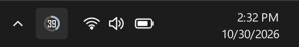

<div align="center">

<h1>
  <picture>
    <source media="(prefers-color-scheme: dark)" srcset="docs/brand/quotaring-horizontal-dark.svg">
    
  </picture>
</h1>

**Claude Code, Codex and Antigravity usage limits as a ring in your tray.**

[](https://github.com/berat-kaan-akcan/quotaring/actions/workflows/ci.yml)
[](https://github.com/berat-kaan-akcan/quotaring/releases/latest)
[](LICENSE)


<table>
  <tr>
    <td align="center" width="33%">
      <picture>
        <source media="(prefers-color-scheme: light)" srcset="docs/images/limits-light.png">
        
      </picture>
    </td>
    <td align="center" width="33%">
      <picture>
        <source media="(prefers-color-scheme: light)" srcset="docs/images/tokens-light.png">
        
      </picture>
    </td>
    <td align="center" width="33%">
      <picture>
        <source media="(prefers-color-scheme: light)" srcset="docs/images/settings-light.png">
        
      </picture>
    </td>
  </tr>
  <tr>
    <td align="center"><b>Limits</b><br><sub>what each provider reports</sub></td>
    <td align="center"><b>Tokens</b><br><sub>from local logs, with API-price estimate</sub></td>
    <td align="center"><b>Settings</b><br><sub>applied as you change them</sub></td>
  </tr>
</table>

**⬇ Install:** [**Windows**](#install-on-windows) · [**Linux**](#install-on-linux) · [macOS (experimental)](#macos-experimental) · [all downloads](https://github.com/berat-kaan-akcan/quotaring/releases/latest)

[What is supported](#what-is-supported) · [Privacy](#privacy-and-security) · [Build from source](#build-from-source)

</div>

> [!IMPORTANT]
> **Unofficial.** QuotaRing is an independent project, not affiliated with or endorsed by
> Anthropic, OpenAI or Google. Product names belong to their owners. Some limits are read through
> undocumented interfaces (see [What is supported](#what-is-supported)) that can change or stop
> working with any provider update.

## Features

- 🟢 **One glance.** The tray icon is a ring around the tightest limit left, turning amber and red as it runs out.

  <picture>
    <source media="(prefers-color-scheme: light)" srcset="docs/images/taskbar-light.png">
    
  </picture>

- 🧭 **Every limit in one popup.** 5-hour and weekly windows for Claude Code and Codex; for Antigravity, every model in its own row with its group's 5-hour and weekly limit on two rings — the same numbers as its *View Usage* panel, Gemini 4 Argon included.
- 📊 **Where the tokens went.** Today, 5 hours, 7 days, 30 days or all scanned (last 35 days for JSONL logs): totals, the input / output / cache split, daily columns with their values, and every model — for all tools or one.
- 💵 **What it would cost on the API.** Each model and total is priced at API list rates, cache included. Prices update themselves weekly.
- 🔒 **No credentials touched.** Limits come from each tool's own CLI or local server; files are opened read-only.
- 🔔 **Notifications** once per limit window: warning levels of your choice (presets 50–95 % or any custom percentage), limit full, limit reset; per provider, with a mute in the tray menu. Each notification carries the limit's ring as its icon, and clicking one opens the popup.
- ⬆️ **Updates itself.** A new release shows up in the popup; *Update* installs it and restarts, checked against the release's SHA-256 sums.
- 🖥️ **Linux and Windows.** GNOME and KDE, X11 and Wayland (layer-shell popup on Plasma); runs from source on macOS (experimental, untested); English and Turkish.

## Download

Pick your system. The one-line command is the quickest way: it downloads, checks the checksum,
installs and starts QuotaRing. The direct downloads below it are for installing by hand.
Either way, QuotaRing [updates itself](#using-it) afterwards.

### Install on Windows

Windows 10/11. Paste in PowerShell:

```powershell
irm https://raw.githubusercontent.com/berat-kaan-akcan/quotaring/main/install.ps1 | iex
```

It installs for your user only, with no admin rights, and adds a Start menu entry.

**Or download directly:**
[quotaring-setup.exe](https://github.com/berat-kaan-akcan/quotaring/releases/latest/download/quotaring-setup.exe) (installer, open it) ·
[quotaring-windows-x64.zip](https://github.com/berat-kaan-akcan/quotaring/releases/latest/download/quotaring-windows-x64.zip) (portable, extract and run `quotaring.exe`)

> [!NOTE]
> The downloads are not code-signed, so SmartScreen may say "Windows protected your PC".
> Choose **More info → Run anyway**, or use the command above.

### Install on Linux

x86_64. Paste in a terminal:

```sh
curl -fsSL https://raw.githubusercontent.com/berat-kaan-akcan/quotaring/main/install.sh | sh
```

When it finishes, the icon is in the system tray: click it to open the popup. Before you paste,
here is exactly what it installs (`sudo` asks for your password only when something is missing):

| System | QuotaRing goes to | System packages added if missing |
|---|---|---|
| Debian / Ubuntu | `/opt/quotaring` (a `.deb`, through apt) | the `.deb`'s dependencies |
| Arch / CachyOS / Manjaro | `~/.local/bin/quotaring.AppImage` | `fuse2` |
| Fedora | `~/.local/bin/quotaring.AppImage` | `fuse-libs` |
| openSUSE | `~/.local/bin/quotaring.AppImage` | `libfuse2` |

It also adds an app-menu entry and the `quotaring` command. FUSE 2 is what an AppImage needs to run.

**GNOME:** GNOME has no tray of its own, so the command also installs and enables the
*AppIndicator* extension (`gnome-shell-extension-appindicator`); log out and back in once for the
icon to appear. KDE Plasma, Cinnamon and XFCE need nothing extra.

**Or download directly:**

| File | Then |
|---|---|
| [quotaring_amd64.deb](https://github.com/berat-kaan-akcan/quotaring/releases/latest/download/quotaring_amd64.deb) (Ubuntu 22.04+ / Debian 12+) | `sudo apt install ./quotaring_amd64.deb` |
| [quotaring-x86_64.AppImage](https://github.com/berat-kaan-akcan/quotaring/releases/latest/download/quotaring-x86_64.AppImage) (any distribution) | install FUSE 2 (table above), `chmod +x quotaring-x86_64.AppImage`, run it |
| [quotaring-linux-x86_64.tar.gz](https://github.com/berat-kaan-akcan/quotaring/releases/latest/download/quotaring-linux-x86_64.tar.gz) (portable) | extract, run `quotaring/quotaring` |

<details>
<summary>Installer options</summary>

Set them before `sh`, for example `curl -fsSL …/install.sh | QUOTARING_APPIMAGE=1 sh`:

- `QUOTARING_APPIMAGE=1`: the AppImage on Debian / Ubuntu too, instead of the `.deb`.
- `QUOTARING_NO_DEPS=1`: install no system packages; add them yourself first:
  `sudo pacman -S --needed fuse2` (Arch), `sudo dnf install fuse-libs` (Fedora),
  `sudo zypper install libfuse2` (openSUSE), `sudo apt install libfuse2t64` (Ubuntu 24.04+; 22.04: `libfuse2`),
  and on GNOME `gnome-shell-extension-appindicator` from the same package manager, then
  `gnome-extensions enable appindicatorsupport@rgcjonas.gmail.com`.
- `QUOTARING_NO_START=1`: install without starting it.

</details>

### macOS (experimental)

There is no macOS download. QuotaRing can be run from source with Python 3.10+, but it has **not
been tested on a Mac**. Paste in Terminal:

```sh
git clone https://github.com/berat-kaan-akcan/quotaring.git && cd quotaring
python3 -m venv .venv && .venv/bin/pip install -r requirements.txt
.venv/bin/python -m quotaring
```

Start it again later with `cd quotaring && .venv/bin/python -m quotaring`. Known gaps:

- The icon goes in the menu bar. A left click may open its menu instead of the popup; if it does,
  choose *Show* there.
- The Dock shows a Python icon while it runs, as there is no `.app` bundle.
- No *Start at login* and no self-update: update with `git pull` in the `quotaring` folder.

If you try it, an [issue](https://github.com/berat-kaan-akcan/quotaring/issues) saying what worked
and what did not is very welcome.

<details>
<summary>Uninstall</summary>

- Windows: *Settings → Apps → QuotaRing*.
- macOS: delete the `quotaring` folder, and `~/Library/Application Support/quotaring` and `~/Library/Caches/quotaring` for its settings and cache.
- Debian / Ubuntu: `sudo apt remove quotaring`.
- AppImage: `rm ~/.local/bin/quotaring ~/.local/bin/quotaring.AppImage ~/.local/share/applications/quotaring.desktop`.

</details>

Checksums: [SHA256SUMS.txt](https://github.com/berat-kaan-akcan/quotaring/releases/latest/download/SHA256SUMS.txt).
Older versions: [Releases page](https://github.com/berat-kaan-akcan/quotaring/releases).
To build it yourself, including a native Arch package, see [Build from source](#build-from-source).

## Using it

**Tray icon.** A ring around the tightest current limit, with its number (percent left, or used —
your choice in Settings). Hover it for each provider's limits; click it to open the popup above the
panel; right-click for Show / hide, Refresh, Settings, Notifications (on/off, mute for 1 hour or
until tomorrow) and Quit. Click anywhere else or press Esc to close the popup.

**Updates.** When a newer release is out, a banner at the top of the Limits page and an item in
the tray menu offer it. *Update* downloads the file for your kind of install, checks it against the
release's `SHA256SUMS.txt`, installs it and starts the new version:

| Installed from | What *Update* does |
|---|---|
| Windows installer | runs the new installer silently, then starts the app |
| Windows zip, Linux tarball | swaps the folder for the new one (the old one is put back if that fails) |
| AppImage | replaces the AppImage file |
| `.deb` | installs the new package with `apt` through `pkexec` (asks for your password) |
| Arch package, source, non-x86_64 | opens the release page; update with your package manager or `git pull` |

If an update fails, the banner says so and its button opens the release page instead.

**Limits page.** One card per provider. The outer ring is the 5-hour window, the inner ring the
weekly one, in the provider's colour; the middle shows the tightest limit. Hover either ring for
its exact value and reset tooltip, or hover a row below to preview it on the ring; click a row to
keep it there (click again to unpin). Antigravity lists its models one by one — Opus, Sonnet and
GPT-OSS share one pool there, so their numbers match — and the selected model's 5-hour and weekly
limits take the two rings. Drag a card (from anywhere on it) to put the cards in the order you
like; the order is saved. The token strip at the bottom shows today and 7-day totals with a 7-day
bar chart (filterable by provider).

**Tokens page.** Click the token strip at the bottom of the Limits page. Pick a period and a
provider; you get the total, what it would cost at API prices, the input / output / cache split,
the last 7 days as columns labelled with their values, and every model with its provider, cost
and token split.

**Settings page.** The gear icon, *Settings…* in the tray menu, or Ctrl+, (click the gear or `←`
to return). Every change applies as you make it.

The popup grows with its page up to 660 px (less on a small screen); longer pages scroll under
the header. Keys: F5 / Ctrl+R refresh · Ctrl+, settings · Esc close · Ctrl+Q quit.

Command line: `--hidden` (start with the popup closed), `--xwayland` (see Wayland below),
`--debug` (verbose logs), `--print` (collect once and print JSON, no window), `--version`.
Only one instance runs per user; a second launch exits (`--allow-multiple` overrides).

## How it works

The popup keeps two kinds of numbers apart:

| | What it is | Where it comes from |
|---|---|---|
| **Limits** | Account limits: percent left (or used) and reset time | Reported by the provider itself (see below). Never computed locally. |
| **Tokens** | Tokens recorded in local logs, and what they would cost on the API | Local history files, read-only; API list prices |

Local token counts are **not** quota: remaining quota is never derived from them. If a limit
can't be retrieved, the card says why — not signed in, no plan limits, limit check paused, no
limit data — and old values are dimmed and marked with when they were last updated.

The cost is an estimate of what the same tokens would cost at the provider's pay-as-you-go API
prices; subscriptions are not billed per token. Prices come from
[LiteLLM's price list](https://github.com/BerriAI/litellm), with
[OpenRouter's model list](https://openrouter.ai/api/v1/models) for models LiteLLM lacks (such as
Gemini 4 Argon) and a built-in table for the rest. The lists are downloaded at most once a week;
the Tokens page shows their date. Models without a known price are left out of the total.

## What is supported

| Provider | Local tokens | Account limits |
|---|---|---|
| **Claude Code** | `~/.claude/projects/**/*.jsonl` (`$CLAUDE_CONFIG_DIR` if set; last 35 days, exact counts per API response, deduplicated) | 5-hour and weekly limits, plus per-model weekly caps, via the `claude` CLI's `get_usage` control request (**experimental and undocumented**; verified with Claude Code 2.1.312). Rejected-request `quotaLimits` entries in local logs also mark a hit limit immediately until its reset. |
| **Codex** | `~/.codex/sessions` and `archived_sessions` rollout logs (`$CODEX_HOME` if set; last 35 days) | ChatGPT-plan limits via `codex app-server` → `account/rateLimits/read` (documented). API-key accounts show *No plan limits for this account*. **Not yet tested on a real Codex install.** |
| **Antigravity** | `~/.gemini/antigravity{,-ide,-cli}/conversations/*.db` (token counts per model response; internal format, opened read-only) | While Antigravity runs: the *View Usage* groups — Gemini, and Claude and GPT, with 5-hour and weekly limits; Gemini 4 Argon, weekly — from its local language server. Otherwise, per-model limits from the Antigravity IDE's cached account status (marked stale with its age after 6 h). Both undocumented. Covers the `agy` CLI too. |

The weekly Claude limit is account-wide and includes claude.ai chats, which local Claude Code logs
do not contain.

## Settings

| Section | Options |
|---|---|
| Appearance | Theme (system / light / dark) · accent colour (Slate, Ink or Amber; the app icon follows it, the tray ring follows the system panel's light/dark theme, and Amber shifts warnings to orange) · language (system, English, Türkçe) · limits as percent left or used |
| General | Start at login · update API prices · check for updates |
| Notifications | On / off · warning levels (any of 50, 75, 80, 90, 95 %, plus your own from 1–100 % via *+ Custom*; only fresh, provider-reported values; jumps fire only the highest crossed level) · limit full · limit reset (off by default) · which providers · test notification. The tray menu toggles them or mutes for an hour or until tomorrow (muted alerts still count as seen, so unmuting never floods) |
| Providers | Per provider: track it, and check its account limits |
| Advanced | Local refresh interval (60 s) · quota refresh interval (300 s) · query timeout (20 s) · custom `claude` / `codex` paths |

Settings are saved as JSON in `$XDG_CONFIG_HOME/quotaring/settings.json` (default `~/.config/…`)
or `%APPDATA%\QuotaRing\settings.json`. Card order and the limit you pin on a ring are saved too.

The cache (last good results, incremental-scan state, downloaded prices, shown-alert keys, the
last release check and a downloaded update) lives in
`$XDG_CACHE_HOME/quotaring/` or `%LOCALAPPDATA%\QuotaRing\Cache\`. It holds model names, token
counts, message ids, alert window keys and history file paths — no conversation text. Delete it any
time; it is rebuilt.

**Start at login** writes `~/.config/autostart/quotaring.desktop` on Linux (GNOME and KDE) and
`HKCU\Software\Microsoft\Windows\CurrentVersion\Run\QuotaRing` on Windows (the installer's
"Start at login" task writes the same value).

## Privacy and security

- Provider files are only **read**: JSONL files in binary read mode, SQLite with `mode=ro`.
- QuotaRing **never reads, stores or logs credentials**. Limits come from the tools themselves,
  which use their own login:
    - `claude --safe-mode --print --verbose --input-format stream-json --output-format stream-json
      --no-session-persistence --permission-mode dontAsk --tools ""` in an empty temp folder,
      sending only the `initialize` and `get_usage` control requests (no model turn, no tools, no hooks).
    - `codex app-server`, sending `initialize`, `account/read` (without token refresh) and
      `account/rateLimits/read`.
    - Antigravity's own language server on 127.0.0.1 (`agy --hub`; port and CSRF token from its
      command line), asked `RetrieveUserQuotaSummary` and, for model names only, `GetUserStatus`.
      Only processes owned by the current user are considered, so another user cannot feed it
      made-up limits. When Antigravity is not running, its IDE `state.vscdb` is
      queried read-only for the single `antigravityUnifiedStateSync.userStatus` key, decoding only
      model quota fractions, reset timestamps and plan tier (never OAuth tokens, name or email).
- The only requests to the internet are the two public price lists for the cost estimate, at
  most once a week, and GitHub's public API for the latest QuotaRing release, at most twice a day;
  neither carries identifiers. Turn off *Update API prices* to use the built-in table only, and
  *Check for updates* to never ask GitHub. Downloads happen only when you press *Update*.
- The CLIs' stderr is discarded. Every query has a timeout and at most 3 attempts with backoff;
  quota checks speed up to every 2 minutes above 80 % used, and rate limiting (HTTP 429) backs
  them off to at least 15 minutes.
- Logs contain paths and error types only. `--debug` adds tracebacks.

## Platform notes and limitations

- **Wayland:** clients cannot place their own windows. On KDE Plasma (and other layer-shell
  compositors) the popup is a layer-shell surface anchored by the panel, through KDE's
  `layer-shell-qt` QML module (`/usr/lib/qt6/qml/org/kde/layershell` and multiarch equivalents).
  On Plasma, KWin's D-Bus scripting interface (`org.kde.KWin`) is asked for the cursor X position
  so the popup opens directly above the clicked tray icon (else in the panel corner). PySide6 from
  pip only loads `layer-shell-qt` when the system Qt has the same version; otherwise, and on GNOME,
  the app runs through XWayland and places the popup itself. `--xwayland` forces that.
- **GNOME tray:** GNOME has no tray by default. Install the *AppIndicator and KStatusNotifierItem
  Support* extension; the Linux install command adds and enables it ([details](#install-on-linux)). Without a tray the popup is an ordinary window that stays open; closing it quits.
- A harmless `qt.qpa.services: Failed to register with host portal` warning appears when running
  from source without an installed `.desktop` file.
- PySide6 6.12 aborts at exit on Python < 3.12 (a reference-counting bug in its bindings);
  `requirements.txt` and `pyproject.toml` therefore select `PySide6-Essentials < 6.12` on those Python versions.
- Antigravity's database format is internal and may change; unreadable data is skipped and the
  number of skipped databases is shown.
- Claude's `get_usage` is experimental; a CLI update can turn it into *No plan limits* or *No limit data*.

## Troubleshooting

| Symptom | Fix |
|---|---|
| Claude/Codex card says "No limit data" (or is missing) though the CLI is installed | Set its full path under Settings → Advanced (GUI sessions may not have `~/.local/bin` on `PATH`). The widget also looks in `~/.local/share/claude/versions/` for the native installer, and honours `$CLAUDE_CONFIG_DIR` / `$CODEX_HOME`. |
| Card says "Not signed in · run … login" | Run `claude` or `codex login` once in a terminal. |
| Card says "No plan limits for this account" | API-key account (no subscription limits) or a CLI version without the query. |
| Antigravity shows one value per model, dimmed with "updated … ago" | Antigravity isn't running: the IDE's cached status is shown. Open Antigravity to get live limits. |
| Numbers look old or dimmed with "updated … ago" | Press ⟳. Dimmed values mean the last refresh failed and the previous reading is kept visible. |
| Want to inspect raw output | `python -m quotaring --print` |
| "already running" but no window | It is in the tray: click the icon. A lock left by a crashed run is taken over automatically. |

## Build from source

### Run from source (Linux, Windows, macOS)
Requires Python 3.10+. (macOS is experimental and untested; see [macOS](#macos-experimental). *Start at login* is Linux/Windows only.)

```sh
git clone https://github.com/berat-kaan-akcan/quotaring.git && cd quotaring
python3 -m venv .venv
.venv/bin/pip install -r requirements.txt         # Windows: .venv\Scripts\pip ... (or: pip install -e .)
.venv/bin/python -m quotaring                       # Windows: .venv\Scripts\pythonw -m quotaring
```

### Linux packages
Recommended: `./packaging/linux/build_in_docker.sh` builds inside Ubuntu 22.04 (glibc 2.35, runs the
tests there first) and produces a bundle that runs on Ubuntu 22.04+, Debian 12+, Fedora, Arch, …:
- Portable: extract `quotaring-<ver>-linux-x86_64-ubuntu22.04.tar.gz`, run `quotaring/quotaring`.
- Debian/Ubuntu: `sudo apt install ./quotaring_<ver>~ubuntu22.04_amd64.deb` (installs to `/opt`).

`./packaging/linux/build_linux.sh` does the same on the host without Docker (the result only runs
on distros at least as new as the build machine).
- Arch/CachyOS: `./packaging/arch/build.sh -s` then `sudo pacman -U packaging/out/quotaring-*.pkg.tar.zst`
  (uses system `python` + `pyside6`).
- AppImage: `./packaging/linux/build_appimage_docker.sh` (downloads and runs appimagetool inside a container).

Frozen builds bundle the build machine's libraries; build on the **oldest** distro you
target (e.g. Ubuntu 22.04) so the result runs on newer ones.

### Windows
In PowerShell from the repo root: `powershell -ExecutionPolicy Bypass -File packaging\windows\build_windows.ps1`.
This runs the tests, builds `dist\quotaring\quotaring.exe`, a zip, and — if
[Inno Setup 6](https://jrsoftware.org/isinfo.php) is installed — a per-user installer
(`packaging\out\quotaring-<ver>-setup.exe`, no admin rights needed).

## Development

```sh
python3 -m venv .venv && .venv/bin/pip install -r requirements-dev.txt
.venv/bin/python -m pytest -q          # synthetic fixtures only; never reads your real data
```

The README images are rendered from synthetic demo data at 2× scale: `.venv/bin/python docs/screenshots.py`.

Layout: `quotaring/model.py` (data types), `quotaring/providers/` (one module per provider behind
`providers/base.py`), `quotaring/aggregate.py` (periods and 35-day retention), `quotaring/engine.py`
(caching, stale handling, scheduling), `quotaring/alerts.py` (once-per-window notifications),
`quotaring/pricing.py` (API prices), `quotaring/i18n.py` (English / Turkish strings),
`quotaring/autostart.py` (login autostart), `quotaring/viewmodel.py` (display-ready view for the
popup), `quotaring/ui/` (tray popup with its Limits, Tokens and Settings pages: `popup.py`,
`cursor_probe.py`, `settings_form.py`, `qml/`), `packaging/` (PyInstaller spec, Linux/Arch/Windows
packaging).

## License

[MIT](LICENSE) © 2026 Berat Kaan Akcan
