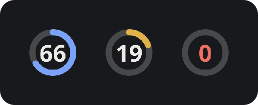
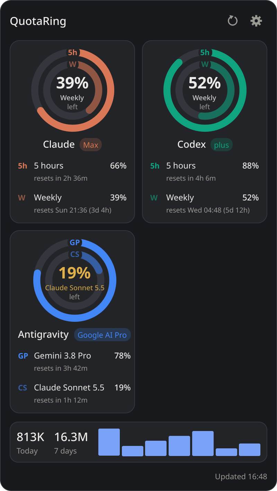
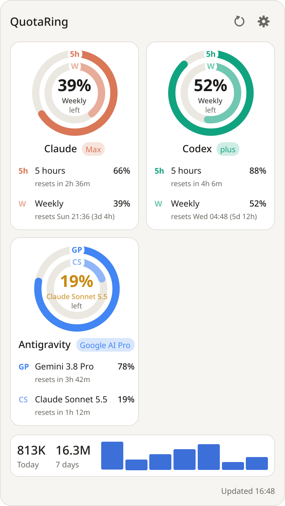
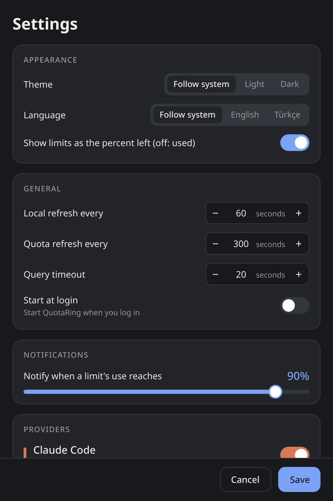

<div align="center">


# QuotaRing

**Claude Code, Codex and Antigravity usage limits as a ring in your tray.**

[](https://github.com/berat-kaan-akcan/quotaring/actions/workflows/ci.yml)
[](https://github.com/berat-kaan-akcan/quotaring/releases/latest)
[](LICENSE)




&nbsp;&nbsp;


[**Download**](#download) · [What is supported](#what-is-supported) · [Privacy](#privacy-and-security) · [Build from source](#build-from-source)

</div>

> [!IMPORTANT]
> **Unofficial.** QuotaRing is an independent project, not affiliated with or endorsed by
> Anthropic, OpenAI or Google. Product names belong to their owners. Some limits are read through
> undocumented interfaces (see [What is supported](#what-is-supported)) that can change or stop
> working with any provider update.

## Features

- 🟢 **One glance:** the tray icon is a ring around the tightest limit left, turning amber and red as it runs out.
- 🧭 **All three tools in one popup:** 5-hour and weekly windows per provider, with reset times.
- 📊 **Local token history:** today, 7 days and a 7-day bar chart from the tools' own logs.
- 🔒 **No credentials touched:** limits come from each provider's own CLI or local cache; files are opened read-only.
- 🔔 **Notifications** when a limit crosses your threshold (default 90 %).
- 🖥️ **Linux and Windows:** GNOME and KDE, X11 and Wayland (layer-shell popup on Plasma); English and Turkish UI.

## Download

Get the latest build from the [Releases page](https://github.com/berat-kaan-akcan/quotaring/releases/latest):

| System | File | Install |
|---|---|---|
| Ubuntu 22.04+ / Debian 12+ | `quotaring_<ver>~ubuntu22.04_amd64.deb` | `sudo apt install ./quotaring_*.deb` |
| Any Linux (x86_64) | `quotaring-<ver>-x86_64.AppImage` | `chmod +x quotaring-*.AppImage` and run it |
| Any Linux (x86_64), portable | `quotaring-<ver>-linux-x86_64-ubuntu22.04.tar.gz` | extract, run `quotaring/quotaring` |
| Windows 10/11 | `quotaring-<ver>-setup.exe` | per-user install, no admin rights |
| Windows, portable | `quotaring-<ver>-windows-x64.zip` | extract, run `quotaring.exe` |

`SHA256SUMS.txt` on each release lists the file checksums.

> [!NOTE]
> The Windows builds are not code-signed, so SmartScreen may show "Windows protected your PC".
> Choose **More info → Run anyway**, or build it yourself (see below).

On GNOME, enable the *AppIndicator and KStatusNotifierItem Support* extension to get a tray
(see [Platform notes](#platform-notes-and-limitations)).

## How it works

The popup keeps two things apart:

| Part | What it is | Where it comes from |
|---|---|---|
| **Ring cards** (one per provider) | Account limits: percent left (or used) and reset time | Reported by the provider itself (see below). Never computed locally. |
| **Token strip** | Tokens recorded in local logs: today, 7 days, last 7 days as bars | Local history files, read-only |

Local token counts are **not** quota. The widget never derives remaining quota from local history.
If a value can't be retrieved, the card says why: not signed in, no limit data, limit check
paused, not installed — and stale values are marked with when they were last updated.

## What is supported

| Provider | Local activity | Account quota |
|---|---|---|
| Claude Code | `~/.claude/projects/**/*.jsonl` (exact counts per API response, deduplicated) | 5-hour and weekly limits (plus per-model weekly caps and the weekly share of Claude Code / claude.ai Chats / Cowork) via the `claude` CLI's `get_usage` control request. **Experimental and undocumented**; may break with a Claude Code update. Verified with Claude Code 2.1.312. |
| Codex | `~/.codex/sessions` and `archived_sessions` rollout logs | ChatGPT-plan limits via `codex app-server` → `account/rateLimits/read` (documented). API-key accounts show *Unsupported*; API billing is never shown as plan quota. **Not tested on a real Codex install** (none on the dev machine). |
| Antigravity | `~/.gemini/antigravity{,-ide,-cli}/conversations/*.db` — token counts stored per model response (undocumented internal format, opened read-only) | Per-model limits (remaining, reset) from the Antigravity IDE's local cache of the account status (undocumented; refreshed while the IDE runs, shown *stale* after 6 h). Covers the `agy` CLI too — same account. |

The weekly Claude limit is account-wide: it includes claude.ai web/desktop chats. Local Claude Code logs do **not** contain claude.ai conversations.
Quota sources are listed per provider above; undocumented ones may break with an update.

## Build from source

### Run from source (any OS)
Requires Python 3.10+.

```sh
git clone https://github.com/berat-kaan-akcan/quotaring.git && cd quotaring
python3 -m venv .venv
.venv/bin/pip install -r requirements.txt         # Windows: .venv\Scripts\pip ...
.venv/bin/python -m quotaring                       # Windows: .venv\Scripts\pythonw -m quotaring
```

### Linux packages
Recommended: `./packaging/linux/build_in_docker.sh` builds inside Ubuntu 22.04 (glibc 2.35, runs the
tests there first) and produces a bundle that runs on Ubuntu 22.04+, Debian 12+, Fedora, Arch, …:
- Portable: extract `quotaring-<ver>-linux-x86_64-ubuntu22.04.tar.gz`, run `quotaring/quotaring`.
- Debian/Ubuntu: `sudo apt install ./quotaring_<ver>~ubuntu22.04_amd64.deb` (installs to `/opt`).

`./packaging/linux/build_linux.sh` does the same on the host without Docker (the result only runs
on distros at least as new as the build machine).
- Arch/CachyOS: `./packaging/arch/build.sh -s` then `sudo pacman -U packaging/out/quotaring-*.pkg.tar.zst`
  (uses system `python` + `pyside6`).
- AppImage: `./packaging/linux/build_appimage_docker.sh` (downloads and runs appimagetool inside a container).

Frozen builds bundle the build machine's libraries; build on the **oldest** distro you
target (e.g. Ubuntu 22.04) so the result runs on newer ones.

### Windows
In PowerShell from the repo root: `powershell -ExecutionPolicy Bypass -File packaging\windows\build_windows.ps1`.
This runs the tests, builds `dist\quotaring\quotaring.exe`, a zip, and — if
[Inno Setup 6](https://jrsoftware.org/isinfo.php) is installed — a per-user installer
(`packaging\out\quotaring-<ver>-setup.exe`, no admin rights needed).

## Use

- The **tray icon** is a ring around the tightest current limit with its number (percent left,
  or used — see Settings); the plain icon when no provider reports limits.
- **Hover** the tray icon: each provider's limits as the percent left.
- **Click** the tray icon: a popup opens above it, by the panel. Click anywhere else, press Esc
  or click the icon again to close it. Right-click the icon for Refresh, Settings, Quit.
- The popup shows one ring card per provider — outer ring the 5-hour window, inner ring the
  weekly one, in the provider's colour; the middle shows the tightest limit — with reset times
  below, and a strip of locally recorded tokens (today, 7 days, last 7 days as bars).
  Each ring is tagged where it starts (5h / W); hover a ring or a row to light that limit.
- Keys in the popup: F5 / Ctrl+R refresh · Ctrl+, settings · Esc close · Ctrl+Q quit.
- The tray tooltip summarizes each provider (quota only when the provider reported it).
- Only one instance runs per user; a second launch exits (`--allow-multiple` overrides).

Command line: `--hidden` (start with the popup closed), `--xwayland` (see Wayland below), `--debug`
(verbose logs), `--print` (collect once and print JSON, no window), `--version`.

## Settings

Saved as JSON in:
- Linux: `$XDG_CONFIG_HOME/quotaring/settings.json` (default `~/.config/...`)
- Windows: `%APPDATA%\QuotaRing\settings.json`



Open Settings from the gear in the popup or the tray menu. Changes apply on Save, without a
restart — including the language (follows the system, Turkish or English, or set it here).

Options: theme (system / light / dark), language, limits as percent left or used, local
refresh interval (default 60 s), quota refresh interval (default 300 s), query timeout (20 s),
start at login, quota notification threshold (default 90 %, only for fresh, provider-reported
values), per-provider tracking and limit-check toggles, custom `claude` / `codex` paths.
The limit pinned to a ring (click a row in the popup) is saved too.

Cache (last good results, incremental-scan state): `$XDG_CACHE_HOME/quotaring/`
or `%LOCALAPPDATA%\QuotaRing\Cache\`. It holds model names, token counts, message ids and
history file paths — no conversation text. Delete it any time; it is rebuilt.

## Start at login

Toggle **Start at login** in Settings.
- Linux: writes `~/.config/autostart/quotaring.desktop` (XDG autostart; works on GNOME and KDE).
- Windows: writes `HKCU\Software\Microsoft\Windows\CurrentVersion\Run\QuotaRing`
  (the installer's "Start at login" task writes the same value).

## Privacy and security

- Provider files are only **read**: JSONL files in binary read mode, SQLite with `mode=ro`.
- The widget **never reads, stores or logs credentials**. Quota is obtained by starting the
  provider's own CLI, which uses its own login:
    - `claude --safe-mode --print --input-format stream-json --output-format stream-json
      --no-session-persistence --permission-mode dontAsk --tools ""` in an empty temp folder,
      sending only the `initialize` and `get_usage` control requests (no model turn, no tools, no hooks).
    - `codex app-server`, sending `initialize`, `account/read` (without token refresh) and
      `account/rateLimits/read`.
- The CLIs' stderr is discarded. Every query has a timeout and at most 3 attempts with backoff;
  rate limiting (HTTP 429) backs the quota check off to at least 15 minutes.
- Logs contain paths and error types only. `--debug` adds tracebacks.

## Platform notes and limitations

- **Wayland:** clients cannot place their own windows. On KDE Plasma (and other layer-shell
  compositors) the popup is a layer-shell surface anchored by the panel, through KDE's
  `layer-shell-qt` QML module (`/usr/lib/qt6/qml/org/kde/layershell`). PySide6 from pip only
  loads it when the system Qt has the same version; otherwise, and on GNOME, the app runs
  through XWayland and places the popup itself. `--xwayland` forces that.
- **GNOME tray:** GNOME has no tray by default. Install/enable the *AppIndicator and
  KStatusNotifierItem Support* extension. Without a tray the popup is an ordinary window
  that stays open; closing it quits.
- A harmless `qt.qpa.services: Failed to register with host portal` warning appears when running
  from source without an installed `.desktop` file.
- PySide6 6.12 aborts at exit on Python < 3.12 (a reference-counting bug in its bindings);
  `requirements.txt` therefore selects PySide6 < 6.12 on those Python versions.
- Antigravity's database format is internal and may change; unreadable data is skipped and the
  count of skipped databases is shown.
- Claude's `get_usage` is experimental; a CLI update can turn it into *Unsupported* or *Unavailable*.

## Troubleshooting

| Symptom | Fix |
|---|---|
| Claude/Codex quota "Not installed" but the CLI is installed | Set its full path in Settings (GUI sessions may not have `~/.local/bin` on `PATH`). |
| Quota "Not authenticated" | Run `claude` or `codex login` once in a terminal. |
| Quota "Unsupported" | API-key account (no subscription limits) or a CLI version without the query. |
| Numbers look old | Hover "updated …"; press ⟳. A *Stale* label means the last refresh failed and old values are shown. |
| Want to inspect raw output | `python -m quotaring --print` |
| "already running" but no window | It is in the tray: click the icon. A lock left by a crashed run is taken over automatically. |
| `claude` installed with the native installer but "Not installed" | The widget also looks in `~/.local/share/claude/versions/`; otherwise set the path in Settings. |

## Development

```sh
python3 -m venv .venv && .venv/bin/pip install -r requirements-dev.txt
.venv/bin/python -m pytest -q          # synthetic fixtures only; never reads your real data
```

The README images come from synthetic demo data: `.venv/bin/python docs/screenshots.py`.

Layout: `quotaring/model.py` (data types), `quotaring/providers/` (one module per provider behind
`providers/base.py`), `quotaring/engine.py` (caching, stale handling, scheduling),
`quotaring/viewmodel.py` (display-ready view for the popup), `quotaring/ui/`
(tray popup and settings window: `popup.py`, `settings_form.py`, `qml/`), `packaging/` (PyInstaller spec, Linux/Arch/Windows packaging).

## Credits

Ideas and protocol knowledge (deduplication strategy, Codex cumulative counters, CLI-based quota
queries) come from two MIT-licensed projects:
[yusufipk/kde-agents-usage](https://github.com/yusufipk/kde-agents-usage) and
[RanulfoMNeto/agent-usage](https://github.com/RanulfoMNeto/agent-usage). No code was copied.

License: [MIT](LICENSE) © 2026 Berat Kaan Akcan.
