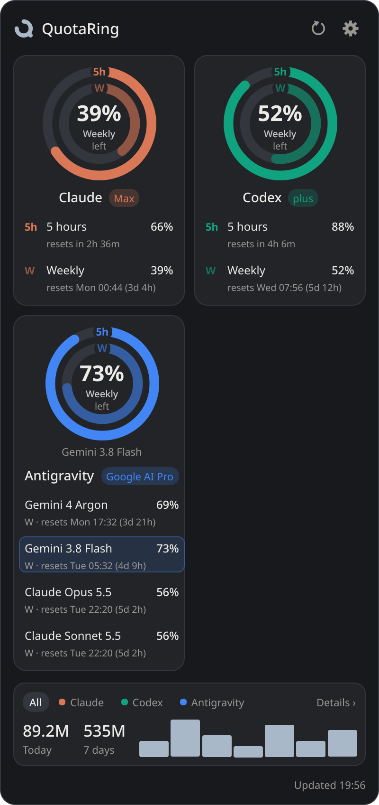
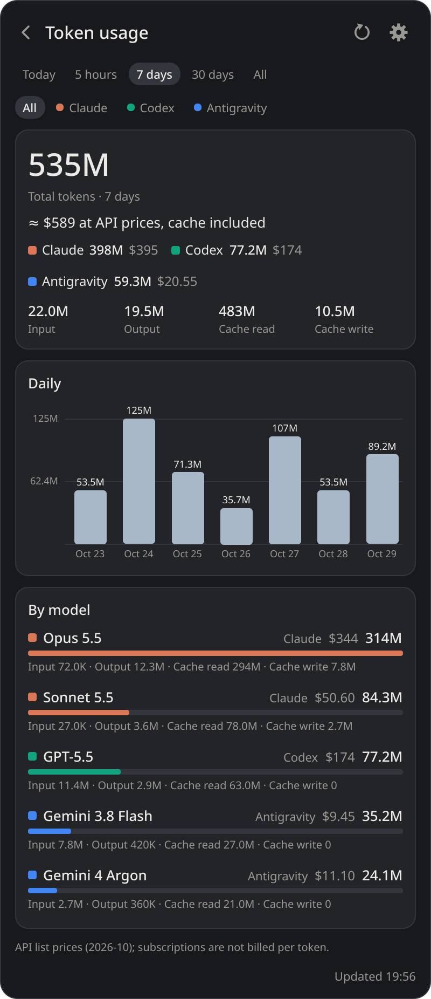

<div align="center">

<h1>
  <picture>
    <source media="(prefers-color-scheme: dark)" srcset="docs/brand/quotaring-horizontal-dark.svg">
    
  </picture>
</h1>

**Claude Code, Codex and Antigravity usage limits as a ring in your tray.**

[](https://github.com/berat-kaan-akcan/quotaring/actions/workflows/ci.yml)
[](https://github.com/berat-kaan-akcan/quotaring/releases/latest)
[](LICENSE)


<table>
  <tr>
    <td align="center" width="33%">
      <picture>
        <source media="(prefers-color-scheme: light)" srcset="docs/images/limits-light.png">
        
      </picture>
    </td>
    <td align="center" width="33%">
      <picture>
        <source media="(prefers-color-scheme: light)" srcset="docs/images/tokens-light.png">
        
      </picture>
    </td>
    <td align="center" width="33%">
      <picture>
        <source media="(prefers-color-scheme: light)" srcset="docs/images/settings-light.png">
        
      </picture>
    </td>
  </tr>
  <tr>
    <td align="center"><b>Limits</b><br><sub>what each provider reports</sub></td>
    <td align="center"><b>Tokens</b><br><sub>from local logs, with API-price estimate</sub></td>
    <td align="center"><b>Settings</b><br><sub>applied as you change them</sub></td>
  </tr>
</table>

[**Download**](#download) · [What is supported](#what-is-supported) · [Privacy](#privacy-and-security) · [Build from source](#build-from-source)

</div>

> [!IMPORTANT]
> **Unofficial.** QuotaRing is an independent project, not affiliated with or endorsed by
> Anthropic, OpenAI or Google. Product names belong to their owners. Some limits are read through
> undocumented interfaces (see [What is supported](#what-is-supported)) that can change or stop
> working with any provider update.

## Features

- 🟢 **One glance.** The tray icon is a ring around the tightest limit left, turning amber and red as it runs out.
- 🧭 **Every limit in one popup.** 5-hour and weekly windows for Claude Code and Codex; for Antigravity, every model in its own row with its group's 5-hour and weekly limit on two rings — the same numbers as its *View Usage* panel, Gemini 4 Argon included.
- 📊 **Where the tokens went.** Today, 5 hours, 7 days, 30 days or all: totals, the input / output / cache split, daily columns with their values, and every model — for all tools or one.
- 💵 **What it would cost on the API.** Each model and total is priced at API list rates, cache included. Prices update themselves weekly.
- 🔒 **No credentials touched.** Limits come from each tool's own CLI or local server; files are opened read-only.
- 🔔 **Notifications** when a limit crosses your threshold (default 90 %).
- 🖥️ **Linux and Windows.** GNOME and KDE, X11 and Wayland (layer-shell popup on Plasma); English and Turkish.

## Download

Get the latest build from the [Releases page](https://github.com/berat-kaan-akcan/quotaring/releases/latest):

| System | File | Install |
|---|---|---|
| Ubuntu 22.04+ / Debian 12+ | `quotaring_<ver>~ubuntu22.04_amd64.deb` | `sudo apt install ./quotaring_*.deb` |
| Any Linux (x86_64) | `quotaring-<ver>-x86_64.AppImage` | `chmod +x quotaring-*.AppImage` and run it |
| Any Linux (x86_64), portable | `quotaring-<ver>-linux-x86_64-ubuntu22.04.tar.gz` | extract, run `quotaring/quotaring` |
| Windows 10/11 | `quotaring-<ver>-setup.exe` | per-user install, no admin rights |
| Windows, portable | `quotaring-<ver>-windows-x64.zip` | extract, run `quotaring.exe` |

`SHA256SUMS.txt` on each release lists the file checksums.

> [!NOTE]
> The Windows builds are not code-signed, so SmartScreen may show "Windows protected your PC".
> Choose **More info → Run anyway**, or build it yourself (see below).

On GNOME, enable the *AppIndicator and KStatusNotifierItem Support* extension to get a tray
(see [Platform notes](#platform-notes-and-limitations)).

## Using it

**Tray icon.** A ring around the tightest current limit, with its number (percent left, or used —
your choice in Settings). Hover it for each provider's limits; click it to open the popup above the
panel; right-click for Refresh, Settings and Quit. Click anywhere else or press Esc to close the popup.

**Limits page.** One card per provider. The outer ring is the 5-hour window, the inner ring the
weekly one, in the provider's colour; the middle shows the tightest limit. Each row below gives a
limit and when it resets. Hover a row to light it on the ring; click it to keep it there.
Antigravity lists its models one by one — Opus, Sonnet and GPT-OSS share one pool there, so their
numbers match — and the selected model's 5-hour and weekly limits take the two rings.
Drag a card (from anywhere on it) to put the cards in the order you like; the order is saved.

**Tokens page.** Click the token strip at the bottom of the Limits page. Pick a period and a
provider; you get the total, what it would cost at API prices, the input / output / cache split,
the last 7 days as columns labelled with their values, and every model with its provider, cost
and token split.

**Settings page.** The gear icon, *Settings…* in the tray menu, or Ctrl+,. Every change applies
as you make it.

The popup grows with its page up to 660 px (less on a small screen); longer pages scroll under
the header. Keys: F5 / Ctrl+R refresh · Ctrl+, settings · Esc close · Ctrl+Q quit.

Command line: `--hidden` (start with the popup closed), `--xwayland` (see Wayland below),
`--debug` (verbose logs), `--print` (collect once and print JSON, no window), `--version`.
Only one instance runs per user; a second launch exits (`--allow-multiple` overrides).

## How it works

The popup keeps two kinds of numbers apart:

| | What it is | Where it comes from |
|---|---|---|
| **Limits** | Account limits: percent left (or used) and reset time | Reported by the provider itself (see below). Never computed locally. |
| **Tokens** | Tokens recorded in local logs, and what they would cost on the API | Local history files, read-only; API list prices |

Local token counts are **not** quota: remaining quota is never derived from them. If a limit
can't be retrieved, the card says why — not signed in, no limit data, limit check paused, not
installed — and old values are marked with when they were last updated.

The cost is an estimate of what the same tokens would cost at the provider's pay-as-you-go API
prices; subscriptions are not billed per token. Prices come from
[LiteLLM's price list](https://github.com/BerriAI/litellm), with
[OpenRouter's model list](https://openrouter.ai/api/v1/models) for models LiteLLM lacks (such as
Gemini 4 Argon) and a built-in table for the rest. The lists are downloaded at most once a week;
the Tokens page shows their date. Models without a known price are left out of the total.

## What is supported

| Provider | Local tokens | Account limits |
|---|---|---|
| **Claude Code** | `~/.claude/projects/**/*.jsonl` (exact counts per API response, deduplicated) | 5-hour and weekly limits, plus per-model weekly caps, via the `claude` CLI's `get_usage` control request. **Experimental and undocumented**; verified with Claude Code 2.1.312. |
| **Codex** | `~/.codex/sessions` and `archived_sessions` rollout logs | ChatGPT-plan limits via `codex app-server` → `account/rateLimits/read` (documented). API-key accounts show *Unsupported*. **Not yet tested on a real Codex install.** |
| **Antigravity** | `~/.gemini/antigravity{,-ide,-cli}/conversations/*.db` (token counts per model response; internal format, opened read-only) | While Antigravity runs (Linux and macOS): the *View Usage* groups — Gemini, and Claude and GPT, with 5-hour and weekly limits; Gemini 4 Argon, weekly — from its local language server. Otherwise, and on Windows, per-model limits from the Antigravity IDE's cached account status (shown *stale* after 6 h). Both undocumented. Covers the `agy` CLI too. |

The weekly Claude limit is account-wide and includes claude.ai chats, which local Claude Code logs
do not contain.

## Settings

| Section | Options |
|---|---|
| Appearance | Theme (system / light / dark) · accent colour (Slate, Ink or Amber; the tray and app icon follow it) · language (system, English, Türkçe) · limits as percent left or used |
| General | Start at login · update API prices · quota notification threshold (off, 80, 90 or 95 %; only for fresh, provider-reported values) |
| Providers | Per provider: track it, and check its account limits |
| Advanced | Local refresh interval (60 s) · quota refresh interval (300 s) · query timeout (20 s) · custom `claude` / `codex` paths |

Settings are saved as JSON in `$XDG_CONFIG_HOME/quotaring/settings.json` (default `~/.config/…`)
or `%APPDATA%\QuotaRing\settings.json`. The limit you keep on a ring is saved too.

The cache (last good results, incremental-scan state, downloaded prices) lives in
`$XDG_CACHE_HOME/quotaring/` or `%LOCALAPPDATA%\QuotaRing\Cache\`. It holds model names, token
counts, message ids and history file paths — no conversation text. Delete it any time; it is rebuilt.

**Start at login** writes `~/.config/autostart/quotaring.desktop` on Linux (GNOME and KDE) and
`HKCU\Software\Microsoft\Windows\CurrentVersion\Run\QuotaRing` on Windows (the installer's
"Start at login" task writes the same value).

## Privacy and security

- Provider files are only **read**: JSONL files in binary read mode, SQLite with `mode=ro`.
- QuotaRing **never reads, stores or logs credentials**. Limits come from the tools themselves,
  which use their own login:
    - `claude --safe-mode --print --input-format stream-json --output-format stream-json
      --no-session-persistence --permission-mode dontAsk --tools ""` in an empty temp folder,
      sending only the `initialize` and `get_usage` control requests (no model turn, no tools, no hooks).
    - `codex app-server`, sending `initialize`, `account/read` (without token refresh) and
      `account/rateLimits/read`.
    - Antigravity's own language server on 127.0.0.1 (`agy --hub`; port and CSRF token from its
      command line), asked `RetrieveUserQuotaSummary` and, for model names only, `GetUserStatus`.
      Only processes owned by the current user are considered, so another user cannot feed it
      made-up limits. Nothing from it is kept except the limits.
- The only requests to the internet are the two public price lists for the cost estimate, at
  most once a week, with no identifiers. Turn off *Update API prices* to use the built-in table only.
- The CLIs' stderr is discarded. Every query has a timeout and at most 3 attempts with backoff;
  rate limiting (HTTP 429) backs the quota check off to at least 15 minutes.
- Logs contain paths and error types only. `--debug` adds tracebacks.

## Platform notes and limitations

- **Wayland:** clients cannot place their own windows. On KDE Plasma (and other layer-shell
  compositors) the popup is a layer-shell surface anchored by the panel, through KDE's
  `layer-shell-qt` QML module (`/usr/lib/qt6/qml/org/kde/layershell`). PySide6 from pip only
  loads it when the system Qt has the same version; otherwise, and on GNOME, the app runs
  through XWayland and places the popup itself. `--xwayland` forces that.
- **GNOME tray:** GNOME has no tray by default. Install the *AppIndicator and KStatusNotifierItem
  Support* extension. Without a tray the popup is an ordinary window that stays open; closing it quits.
- A harmless `qt.qpa.services: Failed to register with host portal` warning appears when running
  from source without an installed `.desktop` file.
- PySide6 6.12 aborts at exit on Python < 3.12 (a reference-counting bug in its bindings);
  `requirements.txt` therefore selects PySide6 < 6.12 on those Python versions.
- Antigravity's database format is internal and may change; unreadable data is skipped and the
  number of skipped databases is shown.
- Claude's `get_usage` is experimental; a CLI update can turn it into *Unsupported* or *Unavailable*.

## Troubleshooting

| Symptom | Fix |
|---|---|
| Claude/Codex limits "Not installed" but the CLI is installed | Set its full path under Settings → Advanced (GUI sessions may not have `~/.local/bin` on `PATH`). The widget also looks in `~/.local/share/claude/versions/` for the native installer. |
| Limits "Not authenticated" | Run `claude` or `codex login` once in a terminal. |
| Limits "Unsupported" | API-key account (no subscription limits) or a CLI version without the query. |
| Antigravity shows one value per model, marked stale | Antigravity isn't running (or this is Windows): the IDE's cached status is shown. Open Antigravity to get live limits. |
| Numbers look old | Press ⟳. *Stale* means the last refresh failed and the previous values are shown. |
| Want to inspect raw output | `python -m quotaring --print` |
| "already running" but no window | It is in the tray: click the icon. A lock left by a crashed run is taken over automatically. |

## Build from source

### Run from source (any OS)
Requires Python 3.10+.

```sh
git clone https://github.com/berat-kaan-akcan/quotaring.git && cd quotaring
python3 -m venv .venv
.venv/bin/pip install -r requirements.txt         # Windows: .venv\Scripts\pip ...
.venv/bin/python -m quotaring                       # Windows: .venv\Scripts\pythonw -m quotaring
```

### Linux packages
Recommended: `./packaging/linux/build_in_docker.sh` builds inside Ubuntu 22.04 (glibc 2.35, runs the
tests there first) and produces a bundle that runs on Ubuntu 22.04+, Debian 12+, Fedora, Arch, …:
- Portable: extract `quotaring-<ver>-linux-x86_64-ubuntu22.04.tar.gz`, run `quotaring/quotaring`.
- Debian/Ubuntu: `sudo apt install ./quotaring_<ver>~ubuntu22.04_amd64.deb` (installs to `/opt`).

`./packaging/linux/build_linux.sh` does the same on the host without Docker (the result only runs
on distros at least as new as the build machine).
- Arch/CachyOS: `./packaging/arch/build.sh -s` then `sudo pacman -U packaging/out/quotaring-*.pkg.tar.zst`
  (uses system `python` + `pyside6`).
- AppImage: `./packaging/linux/build_appimage_docker.sh` (downloads and runs appimagetool inside a container).

Frozen builds bundle the build machine's libraries; build on the **oldest** distro you
target (e.g. Ubuntu 22.04) so the result runs on newer ones.

### Windows
In PowerShell from the repo root: `powershell -ExecutionPolicy Bypass -File packaging\windows\build_windows.ps1`.
This runs the tests, builds `dist\quotaring\quotaring.exe`, a zip, and — if
[Inno Setup 6](https://jrsoftware.org/isinfo.php) is installed — a per-user installer
(`packaging\out\quotaring-<ver>-setup.exe`, no admin rights needed).

## Development

```sh
python3 -m venv .venv && .venv/bin/pip install -r requirements-dev.txt
.venv/bin/python -m pytest -q          # synthetic fixtures only; never reads your real data
```

The README images are rendered from synthetic demo data at 2× scale: `.venv/bin/python docs/screenshots.py`.

Layout: `quotaring/model.py` (data types), `quotaring/providers/` (one module per provider behind
`providers/base.py`), `quotaring/engine.py` (caching, stale handling, scheduling),
`quotaring/pricing.py` (API prices), `quotaring/viewmodel.py` (display-ready view for the popup),
`quotaring/ui/` (tray popup with its Limits, Tokens and Settings pages: `popup.py`,
`settings_form.py`, `qml/`), `packaging/` (PyInstaller spec, Linux/Arch/Windows packaging).

## License

[MIT](LICENSE) © 2026 Berat Kaan Akcan
